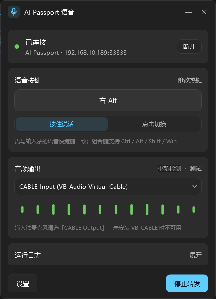

# AI Passport 语音助手

把 AI Passport 硬件的「语音」能力接到 Windows 上：按住设备 **UP** 键说话，识别结果直接落进任意输入框。



> 本项目是 [manchunx7-bit/folo-ai-passport-voice](https://github.com/manchunx7-bit/folo-ai-passport-voice) 中 Windows Python 客户端的原生 .NET 重写版：单文件、零第三方依赖、不依赖 Python 环境。

## 工作原理

```
AI Passport 设备 ──UDP 33333──▶ 本程序
                                  ├─ 键盘注入：按下/抬起输入法语音热键
                                  └─ 音频解码：ADPCM → VB-CABLE（CABLE Input）
                                                        │
                                              输入法麦克风选 CABLE Output
                                                        │
                                                    识别出文字
```

程序不参与语音识别，只做两件事：**替你在电脑上按住语音热键**，以及**把设备麦克风的音频送进虚拟声卡**。

## 功能

- 自动发现局域网内的设备，断线自动重连
- 实时 ADPCM 解码并写入 VB-CABLE，端到端延迟约 100–200 ms
- 两种热键模式：**按住说话**（hold）/ **点击切换**（tap）
- 热键可在主界面直接录制修改，支持组合键
- 实时音量电平、运行日志、日志落盘
- 托盘常驻、开机自启、最小化到托盘
- 深色 / 浅色 / 跟随系统三种主题

## 系统要求

| 项目 | 要求 |
|---|---|
| 系统 | Windows 10 / 11 x64 |
| 运行库 | 无需安装（单文件自包含） |
| 虚拟声卡 | [VB-CABLE](https://vb-audio.com/Cable/) |
| 硬件 | 支持「语音」的 AI Passport 设备，与电脑同一局域网 |

## 下载与运行

1. 到 [Releases](https://github.com/CN-P5/ai-passport-voice-assistant/releases) 下载 `AiPassportVoice.exe`
2. 安装 VB-CABLE 并**重启电脑**（声卡驱动必须重启才生效）
3. 双击 `AiPassportVoice.exe`，**不要**用管理员身份运行（见下方说明）
4. 设备上进入「AI语音」
5. 输入法的语音识别麦克风选择 **CABLE Output**
6. 鼠标点进任意输入框，按住设备 **UP** 键说话，松开即出字

> 建议把程序放在一个普通目录（例如 `D:\AiPassportVoice\`），不要放在被安全软件或沙箱工具标记过的目录里。

## 设置说明

| 选项 | 说明 |
|---|---|
| **语音按键** | 点「修改热键」或直接点键帽，按下你要用的键即可录制；支持单键（右 Alt）、组合键（Ctrl+Shift+H），`Esc` 取消 |
| **按住说话 / 点击切换** | hold：按住设备 UP 期间持续按住热键；tap：按一次触发开始、再按一次结束，适合点击式输入法 |
| **音频输出** | 选择虚拟声卡播放端点，默认 `CABLE Input`；「重新检测」会重测声卡并刷新列表 |
| **开机自动启动** | 写入当前用户注册表 Run 项，无需管理员 |
| **启动后最小化到托盘** | 开机自启时不弹窗 |
| **写入日志文件** | 日志写入 exe 同级 `logs\app-YYYYMMDD.log`，便于排查 |
| **主题** | 深色 / 浅色 / 跟随系统 |

标题栏三个按钮：`▾` 收进托盘（转发继续运行）、`—` 最小化到任务栏、`✕` 退出（会询问是否停止转发）。

## 常见问题

**热键没反应 / 提示被占用**

其他软件可能占用了同一个全局热键（例如企业微信默认使用右 Alt）。在对方设置里改掉，或换一个键。

**输入法收不到按键**

部分输入法（如豆包输入法）会过滤程序合成的按键，只响应真实键盘。此时键盘注入对它无效，需要改用硬件 HID 方案。微信、微信输入法、WorkBuddy 等不受影响。

**托盘图标不见了**

以管理员身份运行时，Windows 会把托盘图标隔离到提权会话，普通桌面看不到。请用**普通权限**双击运行。

**启动失败、提示端口占用**

UDP 33333 已被其他程序占用（常见是旧的实例没退干净，或同时运行了 Python 版）。关闭占用方后点「开始转发」重试。

## 项目结构

```
src/
  AiPassportVoice.App/        WPF 界面、托盘、配置、服务编排
  AiPassportVoice.Core/       协议解析、UDP 传输、转发状态机、ADPCM
  AiPassportVoice.Interop/    winmm 音频输出、键盘注入、设备探测
tests/
  AiPassportVoice.SelfTest/   无第三方依赖的自检程序
build/
  publish.ps1                 一键发布单文件
docs/
  screenshot.png
```

## 从源码构建

需要 .NET 10 SDK：

```powershell
dotnet publish src/AiPassportVoice.App/AiPassportVoice.App.csproj `
  -c Release -r win-x64 --self-contained true `
  -p:PublishSingleFile=true -p:IncludeNativeLibrariesForSelfExtract=true `
  -p:EnableCompressionInSingleFile=true -o dist
```

运行自检：

```powershell
dotnet run --project tests/AiPassportVoice.SelfTest
```

## 致谢

本项目的协议逻辑与音频处理思路来自以下开源项目，在此致谢：

- [manchunx7-bit/folo-ai-passport-voice](https://github.com/manchunx7-bit/folo-ai-passport-voice) — Windows 端 Python 实现，本项目的直接参考
- [zhaohuaxiaoy/folo-ai-passport-voice](https://github.com/zhaohuaxiaoy/folo-ai-passport-voice) — 基础语音实现（MIT）
- [FoloToy/ai-passport](https://github.com/FoloToy/ai-passport) — 硬件与协议基础（MIT）
- [VB-Audio VB-CABLE](https://vb-audio.com/Cable/) — 虚拟声卡

## License

[MIT](LICENSE)
